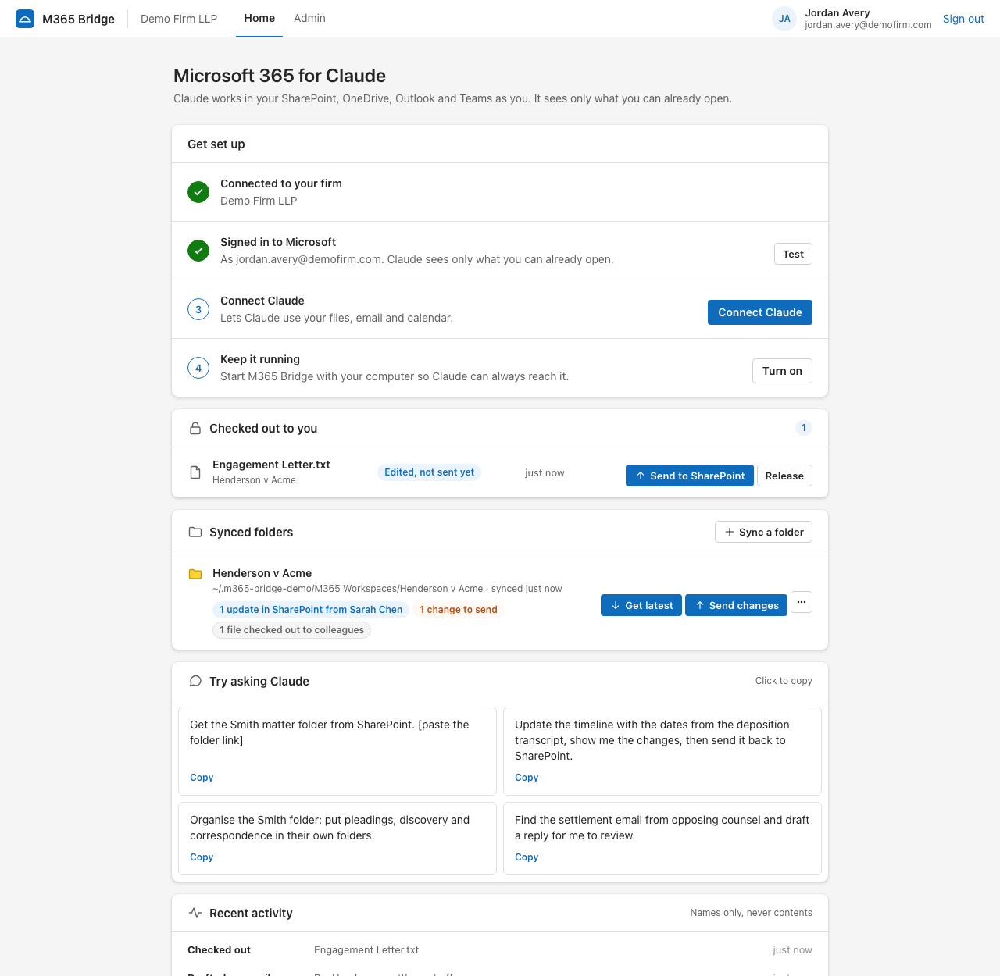
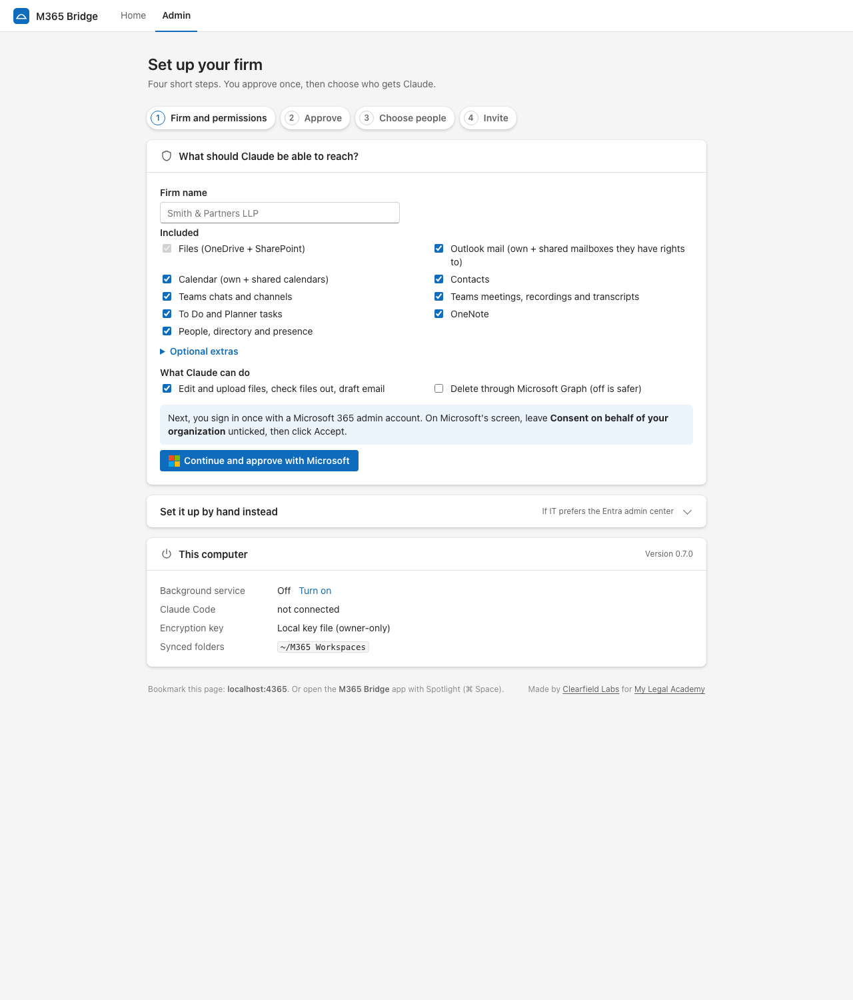
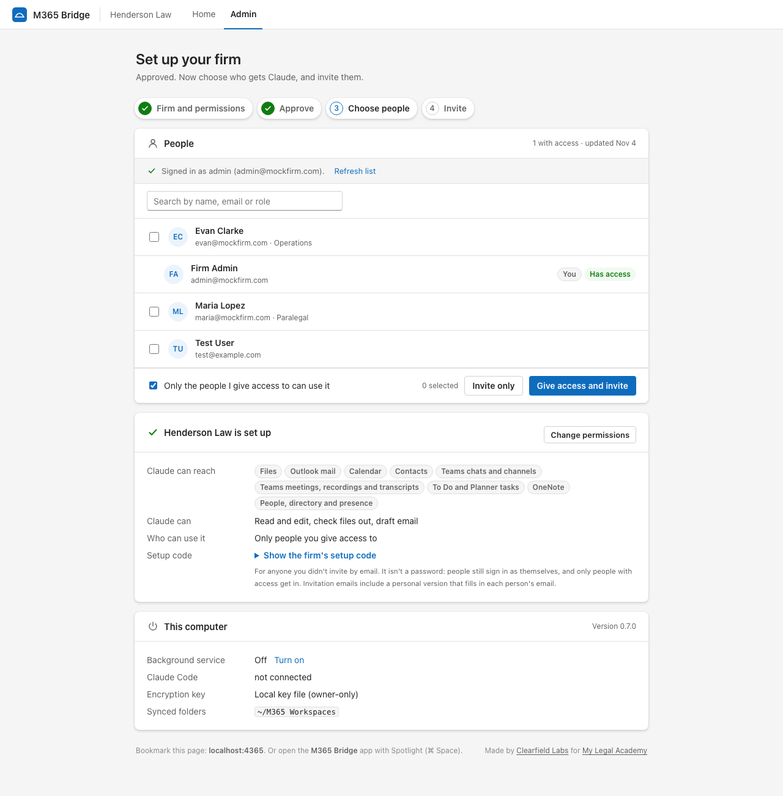
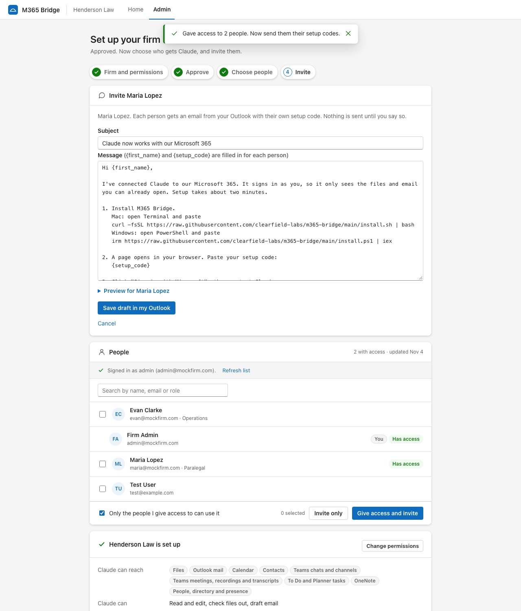
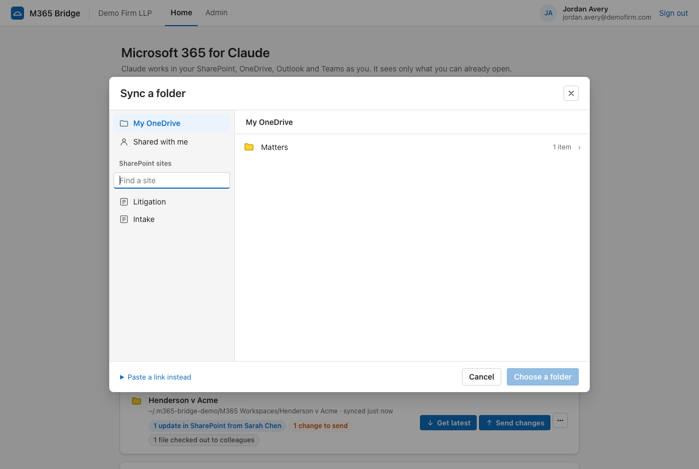

<div align="center">


# M365 Bridge

**A Microsoft 365 MCP server for Claude Code and Claude Desktop.**<br>
SharePoint, OneDrive, Outlook, Teams and calendar, signed in as each person. Shared folders sync like git, with SharePoint check-out so two people never edit the same file.

[](https://github.com/clearfield-labs/m365-bridge/actions/workflows/ci.yml)
[](LICENSE)
[](https://modelcontextprotocol.io)


[Install](#install) · [How it works](#how-it-works) · [For admins](#set-up-a-firm-admin) · [Tools](#what-claude-can-do) · [Security](#security) · [FAQ](#faq)



</div>

## Why

Lawyers, accountants and other firms keep their work in Microsoft 365. Claude Code is the best way to work on documents with AI, but it expects a git repo, and nobody at a law firm wants GitHub.

M365 Bridge makes SharePoint and OneDrive the source of truth instead:

- **Each person signs in as themselves.** Claude reaches only what that person can already open. There are no shared keys and no secrets on laptops.
- **Full Microsoft 365, not a narrow connector.** Files, mail (including shared mailboxes), calendars, Teams chats and transcripts, To Do, Planner, OneNote and any other Microsoft Graph call, within the permissions the admin chooses.
- **Shared folders without overwrites, and nothing to remember.** Before Claude edits a file, it is checked out in SharePoint. When Claude finishes its reply, the file is saved back and checked in with a note in version history, on its own. If two people changed the same file, Claude merges the changes into one file. There are never "copy" files.
- **Email and calendar that fit the day.** Claude drafts in Outlook and sends only when you say so. At the start of a session it already knows your meetings and unread email.
- **Set up in minutes.** One admin approval for the firm, a team list to pick people from, and invitation emails from the admin's own Outlook.
- **Always on.** It starts with the computer and Claude connects to it on its own. Lawyers open it from Spotlight or the Start menu, or bookmark `localhost:4365`.

## Install

One command, nothing to install first (no Git, no Node.js, no admin rights). Step-by-step page: [clearfield-labs.github.io/m365-bridge](https://clearfield-labs.github.io/m365-bridge/).

**Mac** (Terminal):
```bash
curl -fsSL https://raw.githubusercontent.com/clearfield-labs/m365-bridge/main/install.sh | bash
```

**Windows** (PowerShell):
```powershell
irm https://raw.githubusercontent.com/clearfield-labs/m365-bridge/main/install.ps1 | iex
```

The installer runs M365 Bridge in the background from login, connects Claude Code (and the Claude chat app if installed), adds an **M365 Bridge** app or shortcut, and opens `http://localhost:4365`. Run it again to update.

If the computer has no Node.js, the installer downloads a private copy just for M365 Bridge.

## Set up a firm (admin)

Open `http://localhost:4365/admin`. Four steps, about five minutes:

| | |
|---|---|
| **1. Firm and permissions.** Pick what Claude can reach. Optional extras include Bookings, sensitivity labels and Microsoft 365 groups. |  |
| **2. Approve.** Sign in once with a Microsoft 365 admin account. M365 Bridge creates its Entra app and approves exactly those permissions for the firm. | |
| **3. Choose people.** The firm's directory appears. Tick who gets Claude. |  |
| **4. Invite.** One email per person lands in your Outlook drafts, each with a personal setup code. Check one, then send them all. |  |

Afterwards the Admin page shows the setup and everyone's status. Add a new hire with Refresh, tick, invite. Prefer the Entra portal? See [SETUP-ENTRA.md](SETUP-ENTRA.md).

## How it works

```
 Claude Code ──► M365 Bridge (background, on your computer) ──► Microsoft Graph
                 signed in as you                                SharePoint · OneDrive · Outlook · Teams
```

Shared folders work like a git repo:

```
SharePoint folder ──get latest──► ~/M365 Workspaces/Smith v Jones ──send──► SharePoint (new version + note)
                                     │
                                     └── before Claude edits a file: check it out in SharePoint
```

| Step | What happens | When |
|---|---|---|
| **Sync a folder** | Pick it in a folder browser (OneDrive, Shared with me, SharePoint sites) or paste a link. | Once |
| **Get latest** | New and changed files come down. Your edits are never overwritten. Files moved in SharePoint move here too. | Every message you send, and every 5 minutes |
| **Check out** | Colleagues can read the file but not save it. If a colleague holds it, Claude says who. | Before Claude edits a file |
| **Save** | Upload and check in with a note such as "Added deposition dates (via Claude)". Files checked out but unchanged are handed back. | When Claude finishes its reply |
| **Merge** | Only when a file changed on both sides. Claude gets yours, theirs and the original and writes one merged file. | When it happens; Claude is asked straight away |
| **Organise** | Claude renames and moves files and folders in SharePoint and locally together. | When you ask |

A background pass every minute catches the rest: edits made in Word or by a script are saved after 3 quiet minutes, and a check-out left behind by a closed laptop goes back after 10. Advanced users can turn automatic saving off on the page and use Get latest and Send by hand, or the `workspace_*` tools.

People who don't use Claude keep working in Word and SharePoint as usual.



## What Claude can do

| Tools | |
|---|---|
| `status`, `setup`, `firm_setup`, `sign_in` | Set up and sign in from inside Claude |
| `search`, `list_places`, `list_folder`, `read_file` | Find and read anything you can open (Word, PDF, text) |
| `download`, `upload`, `create_folder`, `move` | Single files; uploads never replace a file unless asked |
| `versions`, `restore_version` | Version history and undo |
| `workspace_pull` · `status` · `lock` · `push` · `merge` · `release` · `move` · `list` | Synced folders with check-out, check-in and merges |
| `mail_search`, `mail_read`, `mail_draft`, `mail_send` | Outlook and shared mailboxes. Draft (new, reply, reply all, forward), change the draft, send only when you say so |
| `my_day`, `calendar_view`, `calendar_create`, `calendar_respond` | Today at a glance, any calendar you can see, new events with Teams links, answering invitations |
| `graph_request` | Any other Microsoft Graph call as you: Teams, transcripts, contacts, Planner, OneNote |

Things to ask Claude:
- "Update the Smith timeline from the deposition transcript." It is saved to SharePoint when Claude finishes.
- "What do I have today, and is there anything in my inbox I should deal with first?"
- "Organise the Smith folder into pleadings, discovery and correspondence."
- "Find the settlement email from opposing counsel and draft a reply for me."
- "What's on my calendar tomorrow, and pull the transcript from yesterday's Henderson call."

## Security

- **Delegated access only.** Every request runs as the signed-in person, so Microsoft enforces their own permissions. No app-only keys, no client secrets.
- **Encrypted at rest.** Settings and sign-ins use AES-256-GCM with the key in macOS Keychain or Windows DPAPI.
- **Local only.** The page and Claude's endpoint listen on 127.0.0.1. Other Host headers and cross-site requests are refused, and Claude's connection needs a per-computer key.
- **Nothing is deleted.** Sync never deletes in SharePoint, and every upload is a new version.
- **Activity log** of actions and file names, never contents.
- **Admin setup** signs in through Microsoft's own Graph Command Line Tools app; that token stays in memory and is never saved.

Report a vulnerability: see [SECURITY.md](SECURITY.md).

## FAQ

**How do I connect Claude Code to SharePoint?** Install M365 Bridge, paste your firm's setup code, sign in with Microsoft. Claude Code gets an `m365` MCP server with SharePoint, OneDrive, Outlook and Teams tools.

**How is this different from Claude's Microsoft 365 connector?** The connector covers a fixed set of read features. M365 Bridge lets the admin choose the full delegated Graph scope, writes back to SharePoint with check-out and version notes, and syncs folders for Claude Code to work on locally.

**Can one person see another person's email or files?** No. Each person's token is their own, and Microsoft checks their access on every request. Admins choose who can use it at all.

**Does it work in the Claude desktop app?** Yes. Claude Code (desktop and terminal) connects to the background service over HTTP; the Claude chat app runs the same tools locally.

**What if two people edit the same document?** The second person's Claude sees the file is checked out and stops. If a file still changed on both sides, Claude merges the two into one file.

**Do lawyers have to remember to push and pull?** No. Getting latest and saving happen on their own: when you send Claude a message, and when Claude finishes. A check-out is held only while Claude works, and a background pass hands back any left behind.

**Will Claude send email on its own?** No. It drafts in Outlook and shows you. It sends only when you tell it to.

**Is my firm's data sent anywhere else?** M365 Bridge talks only to Microsoft Graph and runs on your computer. Claude sees what you ask it to work on, under your Claude plan's terms.

## Status

Beta. Tested end to end against a mock Microsoft Graph (31 tests, CI on Windows, macOS and Linux) and on a real law firm tenant (admin setup, sign-in, reads, sync). Run a pilot with a test folder before real matters.

```bash
npm install
npm test        # end-to-end against a mock Microsoft Graph
npm run demo    # the real page against a fake Microsoft 365, at localhost:4366
```

## Credits

Built by [Irfad Imtiaz](https://github.com/irfad7) at [Clearfield Labs](https://github.com/clearfield-labs) ([clearfieldlabs.com](https://clearfieldlabs.com)) for [My Legal Academy](https://github.com/redwoodmeridian) ([mylegalacademy.com](https://mylegalacademy.com)) and the law firms in its AI Labs.

If M365 Bridge saves your firm time, a star helps others find it.

## License

[MIT](LICENSE)
